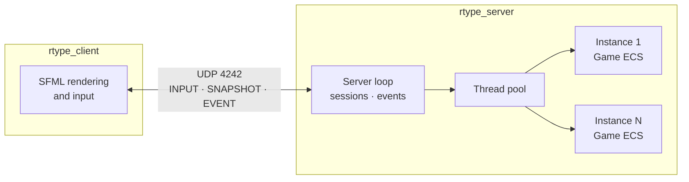

# R-Type


A networked, cooperative horizontal shoot'em up written in modern C++. Players
pilot spaceships together, dodge enemy fire and destroy waves of enemies, while
an authoritative server simulates every game and streams its state to the
clients over a custom binary UDP protocol.

## Table of contents

- [Features](#features)
- [Architecture](#architecture)
- [Getting started](#getting-started)
- [Usage](#usage)
- [Project structure](#project-structure)
- [Documentation](#documentation)
- [Contributing](#contributing)

## Features

- **Authoritative multi-instance server**: one process hosts several
  independent games, each simulated in parallel on a worker thread pool at a
  fixed tick rate.
- **Entity-Component-System engine**: entities, sparse component arrays and
  systems for movement, shooting, enemies, collisions and snapshots.
- **Custom binary UDP protocol**: compact big-endian packets with strict
  validation, state snapshots, and reliable events with acknowledgements and
  retransmission.
- **Session management**: per-client sessions, instance creation and joining,
  inactivity timeouts and chat messages relayed to every player of an instance.
- **SFML client** with animated sprites and packed assets (`assets.pak`).
- **Cross-platform build** with CMake presets and vcpkg-managed dependencies.

## Architecture



| Module | Target | Description |
| --- | --- | --- |
| `network/` | `rtype_network` (static library) | UDP transport (Asio), packet types and binary codec, shared by client and server |
| `game/` | `rtype_game` (static library) | ECS game simulation, independent from rendering and networking |
| `server/` | `rtype_server` | Sessions, instances, tick scheduling, event delivery |
| `client/` | `rtype_client` | Rendering, animations, assets and input with SFML |

## Getting started

### Prerequisites

| Tool | Version |
| --- | --- |
| C++ compiler | C++20 (GCC, Clang or MSVC x64) |
| CMake | 3.20 or later |
| vcpkg | Recent, with `VCPKG_ROOT` set |
| Python | 3, used to generate `assets.pak` |
| Make (Linux) / Ninja (Windows) | Any recent version |

Dependencies (Asio, SFML 3, OpenSSL) are declared in `vcpkg.json` and installed
automatically by vcpkg during the first configuration. On Linux, SFML also needs
the X11, OpenGL and udev development packages; see the
[build guide](docs/build.md) for the full list.

### Build

**Linux**

```sh
export VCPKG_ROOT="$HOME/vcpkg"
cmake --preset=linux
cmake --build build-linux --parallel
```

**Windows** (x64 Native Tools Command Prompt for VS 2022)

```powershell
$env:VCPKG_ROOT = "C:\vcpkg"
cmake --preset=windows -DVCPKG_TARGET_TRIPLET=x64-windows
cmake --build build-windows --parallel
```

The first configuration can take several minutes while vcpkg builds the
dependencies. Debug builds and targeted builds are described in the
[build guide](docs/build.md).

## Usage

Start the server (UDP port **4242**, 20 ticks per second):

```sh
./build-linux/rtype_server
```

Start a client from the build directory, so that it finds `assets.pak`, and give
it the IPv4 address of the server (`127.0.0.1` by default):

```sh
cd build-linux
./rtype_client 127.0.0.1
```

On Windows, use `build-windows\rtype_server.exe` and
`build-windows\rtype_client.exe`.

## Project structure

```text
.
├── client/          # SFML client: include/, src/, assets/, tools/pack_assets.py
├── game/            # ECS engine and game rules
├── network/         # UDP transport and binary protocol
├── server/          # Authoritative server: sessions, instances, events
├── docs/            # MkDocs documentation sources
├── CMakeLists.txt   # Targets and dependencies
├── CMakePresets.json
├── vcpkg.json       # C++ dependencies
└── mkdocs.yml       # Documentation site configuration
```

## Documentation

| Page | Content |
| --- | --- |
| [Build and run](docs/build.md) | Prerequisites, presets, Debug builds, troubleshooting |
| [Server](docs/server.md) | Threads, main loop, sessions, instances, events, timeouts, limitations |
| [Game engine](docs/engine.md) | ECS design, components, systems and update order |
| [Game and gameplay](docs/game.md) | Rules, enemies, scoring |
| [Networking guide](docs/network.md) | Using the `network/` module in a client or server |
| [Network protocol](docs/protocol.md) | Byte-level specification of every packet |

To browse the documentation as a website:

```sh
python3 -m venv .venv
source .venv/bin/activate
python -m pip install -r requirements-docs.txt
python -m mkdocs serve          # http://127.0.0.1:8000
python -m mkdocs build --strict # static site in site/
```

## Contributing

- Create a branch per feature, named after the module it touches
  (`server/multi-instances`, `build/cmake`, `doc/mkdocs`...), and open a pull
  request to `main`.
- Write commit messages following [Conventional Commits](https://www.conventionalcommits.org/):
  `feat:`, `fix:`, `build:`, `docs:`, `refactor:`.
- The `network`, `game` and `server` targets are built with
  `-Wall -Wextra -Werror`: the build must be warning-free.
- Update the documentation in `docs/` together with the code, especially
  [protocol.md](docs/protocol.md) when a packet changes.
